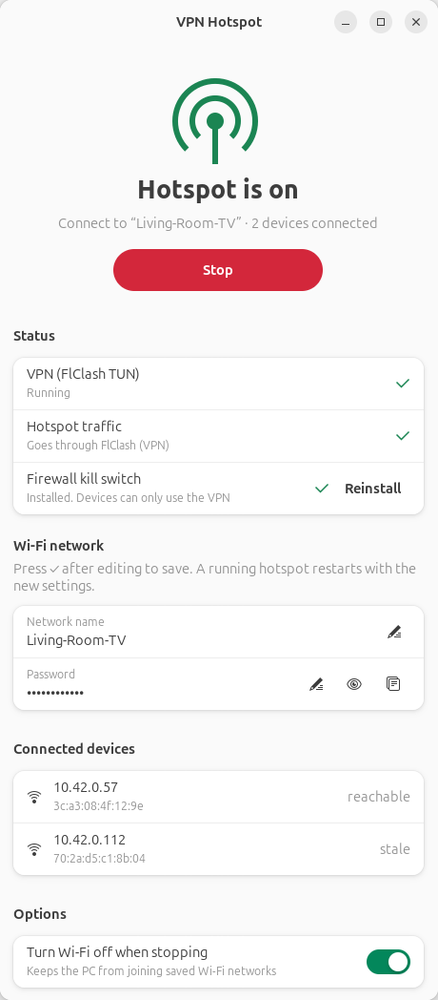

# VPN Hotspot for Linux: share your PC's VPN with a Smart TV over Wi-Fi

**VPN Hotspot** is a free, open-source GNOME app for Ubuntu and other Linux
desktops. It turns your PC's Wi-Fi card into a **Wi-Fi hotspot that sends all
traffic through your VPN** (FlClash / Clash Meta / Mihomo in TUN mode). It's
for devices that can't run a VPN app themselves, such as a **Smart TV,
Android TV, Apple TV, Fire TV Stick, PlayStation, Xbox, Nintendo Switch** or
an older phone.

A built-in **VPN kill switch** means hotspot devices never leak to your real
connection: if the VPN goes down, they lose internet instead of bypassing it.

<p align="center">
  <picture>
    <source media="(prefers-color-scheme: dark)" srcset="docs/screenshot-dark.png">
    
  </picture>
</p>

---

## The problem

You have a working VPN on your Linux PC, but:

- Your **TV or game console has no VPN app**, or the app store doesn't offer
  your VPN client.
- **Sideloading VPN apps** onto a TV is slow, fiddly, and often blocked.
- Setting up a **VPN on your router** means flashing new firmware or buying a new router.
- The **built-in GNOME/Ubuntu "Wi-Fi Hotspot"** shares your internet, but it
  doesn't promise the traffic goes through the VPN. And when the VPN drops,
  devices silently fall back to your normal, unprotected connection.

## The solution

VPN Hotspot makes the PC a VPN router with one button:

1. It creates a **WPA2 Wi-Fi hotspot** using NetworkManager.
2. FlClash's **TUN mode** captures the hotspot traffic, so every connected
   device uses the VPN exactly as the PC does, with the same rules, proxies
   and DNS.
3. It adds **UFW firewall rules** so hotspot traffic can leave **only**
   through the VPN interface. That's the kill switch: no VPN, no internet, no leaks.
4. It **checks the routing live** and shows whether hotspot traffic really goes
   through the VPN, plus which devices are connected.

### Features

- One-click **Start / Stop** of a Wi-Fi hotspot (access point) on Linux
- **All hotspot traffic routed through the VPN**, with a live check
- **Kill switch** using UFW: blocks leaks when the VPN is off
- Shows **connected devices** (IP and MAC address)
- Edit the **Wi-Fi name and password**, with a random strong password by default
- Optionally **turns Wi-Fi off on stop**, so the PC doesn't join other networks
- Native **GTK 4 / libadwaita** app with light and dark themes
- Small and dependency-light: Python plus tools already on Ubuntu
- Packaged as a **.deb** and an **AppImage**

---

## Download

Get the latest version from the **[Releases page](../../releases/latest)**:

| File | For |
|---|---|
| `vpn-hotspot_<version>_all.deb` | Ubuntu, Debian, Linux Mint, Pop!_OS, Zorin OS, elementary OS |
| `VPN_Hotspot-<version>-x86_64.AppImage` | Any 64-bit Linux distro with GTK 4 and libadwaita ≥ 1.5 (Fedora, Arch, openSUSE…) |

## Install guide

### Step 1: Install and set up FlClash

1. Install [FlClash](https://github.com/chen08209/FlClash/releases) and add your
   VPN subscription or profile.
2. In FlClash's settings, turn **TUN mode** on (sometimes labelled "virtual
   network card").
3. Check that the PC itself has VPN internet access.

### Step 2a: Install the .deb (Ubuntu / Debian)

```bash
cd ~/Downloads
sudo apt install ./vpn-hotspot_*_all.deb
```

`apt` also installs any missing dependencies (GTK 4, libadwaita, UFW…).
Then open **VPN Hotspot** from the app menu, or run `vpn-hotspot` in a terminal.

### Step 2b: Run the AppImage (any distro)

```bash
chmod +x VPN_Hotspot-*-x86_64.AppImage
./VPN_Hotspot-*-x86_64.AppImage
```

The AppImage uses your system's Python and GTK, so these must be installed:

| Distro | Command |
|---|---|
| Ubuntu / Debian | `sudo apt install python3-gi gir1.2-gtk-4.0 gir1.2-adw-1 network-manager ufw` |
| Fedora | `sudo dnf install python3-gobject gtk4 libadwaita NetworkManager ufw` |
| Arch | `sudo pacman -S python-gobject gtk4 libadwaita networkmanager ufw` |

If the AppImage won't start with a FUSE error, install `fuse3`
(`sudo apt install fuse3`), or run it with `--appimage-extract-and-run`.

### Step 3: Start the hotspot

1. Make sure FlClash is running with **TUN mode on**.
2. Open **VPN Hotspot** and press **Start**.
3. The first time, it asks for your password to install the firewall
   rules. This is a one-time step.
4. On your TV, connect to the Wi-Fi name shown in the app. Use the copy
   button to grab the password.

The **Status** section tells you if FlClash is up, if hotspot traffic really
goes through it, and if the kill switch is installed.

### Requirements

- Linux with **NetworkManager** and **UFW** (Ubuntu 22.04+ / 24.04 recommended)
- **GTK 4** and **libadwaita ≥ 1.5** with Python bindings (`python3-gi`)
- **FlClash** with **TUN mode** on
- A **Wi-Fi card that supports AP (access point) mode**. Check it with
  `iw list | grep -A8 "Supported interface modes"` and look for `* AP`.
- While the hotspot is on, the PC must reach the internet through **Ethernet**
  or a second Wi-Fi adapter. Most Wi-Fi cards can't join a network and host a
  hotspot at the same time.

---

## How it works

```
 Smart TV ──Wi-Fi──▶ wlan (hotspot, 10.42.0.1/24) ──▶ FlClash TUN ──▶ VPN server ──▶ internet
                                                          ▲
                        UFW: hotspot traffic may leave ONLY via FlClash (kill switch)
```

- **NetworkManager** runs the hotspot: connection `TV-Hotspot`, WPA2, 2.4 GHz,
  `ipv4.method shared`, which provides DHCP, DNS and NAT.
- **FlClash TUN mode** (`auto-route`) captures forwarded traffic, so hotspot
  devices go through the proxy just as the PC does.
- **UFW rules**, installed once through `pkexec`, let hotspot devices use DHCP
  and DNS on the PC, and only allow forwarding from the hotspot to the `FlClash`
  interface. Everything else from the hotspot is dropped.
- The app checks `ip route get … iif <wifi>` every few seconds to confirm that
  hotspot traffic is routed through the VPN.

---

## Troubleshooting / FAQ

<details>
<summary><b>The TV is connected to the hotspot but has no internet</b></summary>

- Is **FlClash running with TUN mode on**? The "VPN (FlClash TUN)" row must be green.
- Does the "Hotspot traffic" row say **Goes through FlClash (VPN)**? If not,
  restart FlClash's TUN mode, then stop and start the hotspot.
- Is the **firewall kill switch installed**? Press **Install** or **Reinstall**.
- Is UFW blocking forwarding? Run `sudo ufw status verbose`. The app's rules
  are marked `vpn-hotspot`.
</details>

<details>
<summary><b>The TV can't see the Wi-Fi network</b></summary>

- The hotspot uses **2.4 GHz** for the best compatibility. Make sure the TV
  supports 2.4 GHz Wi-Fi.
- Check that your Wi-Fi card supports **AP mode** (see Requirements).
- Wi-Fi may be blocked: run `rfkill list`, then `rfkill unblock wifi`.
</details>

<details>
<summary><b>"Wi-Fi adapter did not become available"</b></summary>

Wi-Fi is blocked by a hardware switch or by `rfkill`. Run `rfkill unblock wifi`,
or turn on Wi-Fi from the system menu.
</details>

<details>
<summary><b>My PC lost internet when I started the hotspot</b></summary>

The Wi-Fi card is now busy hosting the hotspot, so it can't stay connected to
your home Wi-Fi. Connect the PC with an **Ethernet cable**, or use a second
(USB) Wi-Fi adapter.
</details>

<details>
<summary><b>Streaming is slow or buffers in 4K</b></summary>

Speed depends on your Wi-Fi card and the VPN server. Older 2.4 GHz cards with one
antenna give about 20–50 Mbps, which is fine for HD but may buffer in 4K. Try
a closer or faster VPN server, or a better USB Wi-Fi adapter.
</details>

<details>
<summary><b>Does it work with WireGuard, OpenVPN, v2rayN, Hiddify or Clash Verge?</b></summary>

The current version is built for **FlClash TUN mode** (the `FlClash` network
interface). Support for other VPN interfaces is planned. Contributions are welcome.
</details>

<details>
<summary><b>Is this safe? Why does it ask for my password?</b></summary>

The app runs as your normal user. Only the small firewall helper
(`helper/vpn-hotspot-firewall.sh`) runs as root, through `pkexec`, and only
to add or remove its UFW rules. You can read the whole script before you run it.
</details>

---

## Uninstall

```bash
sudo apt remove vpn-hotspot                 # .deb install (AppImage: just delete the file)
nmcli connection delete TV-Hotspot          # hotspot Wi-Fi profile
sudo ufw status numbered                    # then: sudo ufw delete <n> for each "vpn-hotspot" rule
rm -rf ~/.config/vpn-hotspot                # app settings
```

## Build from source

```bash
git clone https://github.com/geek-sajjad/VPN-Hotspot-for.git
cd VPN-Hotspot-for
./bin/vpn-hotspot                       # run without installing
./install.sh                            # or add it to your app menu (no sudo)
python3 -m unittest discover -s tests   # tests
packaging/build-deb.sh                  # → dist/vpn-hotspot_<version>_all.deb
packaging/build-appimage.sh             # → dist/VPN_Hotspot-<version>-x86_64.AppImage
```

Releases are built by GitHub Actions. Bump `__version__` in
`src/vpn_hotspot/__init__.py`, then push a matching tag (`git tag v0.1.0 && git push --tags`).

| Path | What it is |
|---|---|
| `src/vpn_hotspot/backend.py` | nmcli / ip calls, status, config |
| `src/vpn_hotspot/app.py` | GTK 4 / libadwaita window |
| `helper/vpn-hotspot-firewall.sh` | root helper for the UFW rules (`install`, `remove`, `status`) |
| `packaging/` | .deb and AppImage build scripts, desktop file, icon |
| `~/.config/vpn-hotspot/config.json` | app settings (Wi-Fi name and password are stored in NetworkManager) |

## License

[MIT](LICENSE): free to use, change and share.

---

<sub>Keywords: share VPN over Wi-Fi hotspot Linux · VPN hotspot Ubuntu ·
share VPN with Smart TV · Android TV VPN without app · FlClash hotspot ·
Clash Meta / Mihomo TUN hotspot · Linux VPN router · VPN kill switch hotspot ·
GNOME hotspot app · NetworkManager access point · UFW kill switch</sub>
